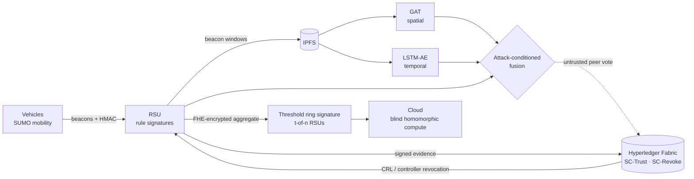

<div align="center">

# 🛡️ SENTINEL · MPTD-PQS

**A Blockchain and GAT with Temporal Autoencoder based Mitigation Scheme for
Mobility Pattern and Trajectory Poisoning Attacks in Software-Defined Vehicular Networks**

Final-year research project · Department of Electrical & Information Engineering,
Faculty of Engineering, University of Ruhuna


</div>

<!-- TODO: add a screenshot or GIF of the SENTINEL demo UI (Network Replay screen works best):
 -->

## The problem

Software-Defined Vehicular Network (SDVN) controllers learn from the positions, speeds and
headings that vehicles report. An attacker can inject **kinematically plausible but falsified
beacons** over time, slowly poisoning the controller's mobility model to cause misrouting,
phantom congestion or suppressed collision warnings, **without tripping conventional detectors**.

- Signatures prove *who* sent a beacon, not that it is *true*.
- Threshold validators are calibrated for slow traffic and break down at high speed.
- Per-vehicle analysis misses coordinated, multi-identity (Sybil) attacks.
- Every reviewed defence trusts the controller, which a single compromise subverts.

## What MPTD-PQS does

A **dual-mode** detection and mitigation framework, evaluated end-to-end in NS-3 + SUMO against
**four attacker classes at once**: malicious vehicles, compromised RSUs, man-in-the-middle, and
malicious controllers — across both the data plane and the control plane.

| Layer | Mechanism | Catches |
|---|---|---|
| **Lightweight (RSU)** | HMAC beacon integrity + 9 formally derived attack signatures (TP-S1…MP-S4) | Kinematic violations, in-transit tampering, replay |
| **Spatial ML** | Multi-task Graph Attention Network (7 attack-type heads) over the dynamic vehicle–RSU graph | Coordinated Sybil configurations visible only relationally |
| **Temporal ML** | LSTM autoencoder with a kinematics-constrained loss | Slow, stealthy trajectory drift |
| **Post-quantum aggregation** | FHE (OpenFHE) *before* ring coordination, then ML-DSA-87 threshold ring signature (*t*-of-*n* RSUs) | Minority-compromised RSUs; cross-RSU data leakage |
| **Trust & revocation** | Hyperledger Fabric smart contracts (SC-Register, SC-Trust, SC-Revoke) + IPFS, RSU-direct BFT consensus | Removes the trusted-controller bottleneck; revokes compromised controllers |



## Results

Evaluated on three real road networks (Shinjuku, Tokyo · Hohenwart, Germany · A9 autobahn),
200 vehicles, 5 experiments and 11 ablation studies, against three published baselines
(Ghaleb 2014, Ercan 2022, Sharma & Liu 2021).

| Finding | Result |
|---|---|
| **Coordinated Sybil attack via compromised RSU** | MCC **0.82–0.99** vs. **≈ 0** for all three baselines |
| **Malicious-controller attacks** (control plane) | MCC **0.98** — baselines are structurally blind (≈ 0) |
| **Full vs. lightweight mode** (stealthy attacks, 20 % attackers) | MCC **0.93** vs. 0.36 |
| **Honest false-positive rate** | **4.3 %** (target ≤ 5 %) |
| **False revocation of honest vehicles** | **0 %** with blockchain BFT vs. **20 %** with centralised revocation |
| **Threshold signing gate** (half the ring compromised) | **60 % more** poisoned aggregates rejected than single-signer |
| **Key management** (200 vehicles per zone) | LKH needs **24.9× fewer** rekey messages than unicast |
| **Real-time cost** | AI layer uses **1–2 %** of the 100 ms beacon budget; PQ signing a fixed ~18 ms per signer per epoch |

Every component was ablated individually; removing the GAT or the LSTM-AE each drops a whole
attack class to chance-level detection, showing the layers are complementary, not redundant.
Full methodology and results: [report](report/main.pdf).

> Some experiments use a small number of random seeds: the ordering of components held on every
> seed, but exact magnitudes may shift with more runs (see the report's Discussion chapter).

## SENTINEL demo UI

A FastAPI + React/deck.gl SOC-style dashboard that replays real simulation runs: live network
map, per-vehicle GAT attention, LSTM-AE reconstruction residuals, blockchain ledger view and an
attack explainer. Runs on pre-recorded scenarios, no simulator needed —
see [`demo_ui/README.md`](demo_ui/README.md).

## Tech stack

**Simulation** NS-3.35 (C++) · SUMO · OpenStreetMap ·
**ML** PyTorch + PyTorch Geometric → ONNX Runtime C++ ·
**Crypto** ML-DSA-87 (Open Quantum Safe) threshold ring signatures · OpenFHE (NIST Level 5) · HMAC · LKH ·
**Blockchain** Hyperledger Fabric (Go chaincode) · IPFS ·
**Demo** FastAPI · React · TypeScript · deck.gl · Tailwind

## Repository layout

```
scratch/mptd_pqs_sdvn/   NS-3 simulation (header-only C++)
gat_detector/            Graph Attention Network training + ONNX export
lstm_detector/           LSTM autoencoder training + ONNX export
chaincode/               Hyperledger Fabric smart contracts (Go)
mptd_pqs/                Python detector package: lightweight, GAT, fusion, baselines, metrics
demo_ui/                 SENTINEL dashboard (FastAPI backend + React frontend)
analysis/                Evaluation, ablation, tuning and plotting scripts
analytics/               ML training code, data and evaluation utilities
results_e*_final/        Final experiment outputs (read by the demo UI)
results/                 Other result files and figures
report/                  Thesis (LaTeX + PDF)
sumo/ · mobility/        SUMO scenarios for the urban, rural and highway maps
docs/                    Run guide, evaluation guide, baseline guide, demo-UI plan
tools/                   Flag-reference generator + pre-commit hook
```

Development notes and review logs from the research process are kept on the
[`research-notes`](https://github.com/NirangaNiluminda/MPTD-PQS-SDVN/tree/research-notes) branch.

## Running it

[`docs/HOW_TO_RUN.md`](docs/HOW_TO_RUN.md) covers building NS-3, the operating modes and every
component toggle; [`RUN_CONFIG.md`](RUN_CONFIG.md) is the generated reference for all CLI flags.
Analysis scripts run from the repo root, e.g. `python3 analysis/heldout_eval.py`.

## Team

| | |
|---|---|
| **G.W.N. Niluminda** — lead developer & system architect | [GitHub](https://github.com/NirangaNiluminda) · [LinkedIn](https://linkedin.com/in/niranganiluminda) |
| H.M.S. Muthukumari | |
| I.J. Niroshan | |
| C.Y. Samarasinghe | |

**Supervisor:** Dr. Tharindu Gamage · **Co-supervisor:** Dr. P.A.D.S. Nilmantha Wijesekara

**My role:** designed the end-to-end architecture and built the NS-3 simulation, the detection
pipeline (rule signatures, GAT and LSTM-AE fusion), the post-quantum and Hyperledger Fabric
integration, the evaluation tooling and the SENTINEL demo UI (≈ 94 % of commits).
